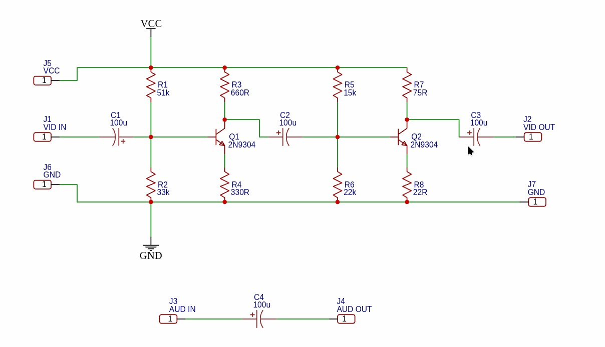
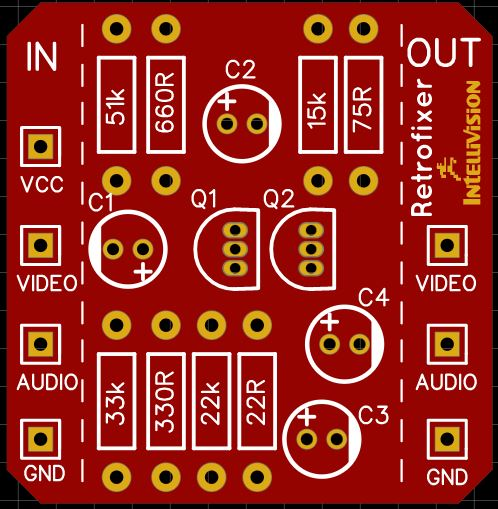

# Video Composites

Hardware designs for adding RCA composite-video and audio outputs to vintage systems. This repository currently contains an **Intellivision** video-output modification.

> The board expects video and audio signals from a console modification point; it is not an RF-to-composite demodulator.

## Intellivision video composite board

The Intellivision design conditions the tapped video signal with a two-stage discrete transistor circuit and brings it out as composite video. Audio is routed through a coupling capacitor to a separate output. The board has connections for power, ground, video in/out, and audio in/out.



| What | Location |
| --- | --- |
| KiCad board source | [`intellivision/project/intellivision-composite.kicad_pcb`](intellivision/project/intellivision-composite.kicad_pcb) |
| KiCad project files | [`intellivision/project/`](intellivision/project/) |
| Board and installation reference images | [`intellivision/doc/`](intellivision/doc/) |
| Model compatibility and installation notes | [`intellivision/doc/COMPATIBILITY.md`](intellivision/doc/COMPATIBILITY.md) |
| Manufacturing files | [`intellivision/gerbers/video-composite-intellivision.zip`](intellivision/gerbers/video-composite-intellivision.zip) |

The image below shows the assembled PCB layout.



### Console compatibility

The same board circuit is suitable for NTSC Intellivision I, Intellivision II,
and Sears Telegames / Super Video Arcade model 497.75022. Each console
provides raw composite video and mono audio ahead of its RF modulator; the
board buffers the high-impedance video signal for a normal 75-ohm composite
input and passes audio to a separate output.

The electrical method and board component values are the same. The physical
installation is not: power, ground, and convenient audio/video solder points,
RF shielding, cable routing, and RCA-jack mounting vary by chassis and
motherboard revision. Read the [compatibility and installation notes](intellivision/doc/COMPATIBILITY.md)
and verify the actual console before soldering.

## Using the design

1. Review the schematic, installation reference image, and [model compatibility notes](intellivision/doc/COMPATIBILITY.md) before modifying a console.
2. Open the KiCad project in `intellivision/project/` to inspect or adapt the board.
3. Use the Gerber ZIP to order the current PCB revision, or regenerate fabrication files from the board source after making changes.
4. Verify signal locations, supply voltage, polarity, and operation on your particular console before permanent installation.

## Repository layout

```text
intellivision/
├── doc/       Reference photos, schematic rendering, and compatibility notes
├── gerbers/   Gerbers, drill files, and manufacturing ZIP
└── project/   KiCad board, schematic, and project settings
```

## License

This project is licensed under the [GNU General Public License v3.0](LICENSE).
