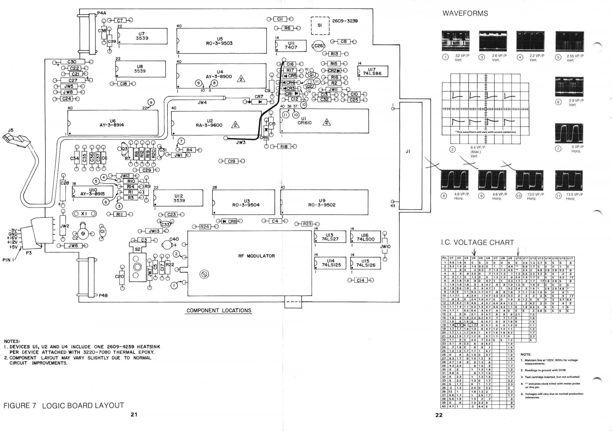

# RF modulator removal — Intellivision composite installation

Removing the RF modulator is **optional**. It recovers space and prevents the
RF circuitry from loading or radiating into the composite installation, but it
is not a simple mechanical deletion: the original modulator contains part of
the console's video bias/pull-up arrangement. Do not remove it until the
replacement composite/shunt circuit has been verified on the target console.

> This note applies to the ASTEC UM1285-8-style metal RF can found in NTSC
> Intellivision-family consoles. Board revisions and case layouts vary. Use
> the board's own traces and the service manual to identify every connection.

The component-layout image identifies the RF-modulator location. For an
example of the nearby video, audio, ground, and +5 V landmarks, see
[`intellivision-point.jpg`](intellivision-point.jpg). Both are installation
references, **not** proof that every motherboard has identical solder points.

## Decision rule

| Installation state | RF-can removal |
| --- | --- |
| Existing Intellivision two-transistor board, without a separately validated shunt/pull-up | **Leave the RF can installed.** |
| New board that explicitly reproduces the required bias/shunt function | Permitted after first-article validation. |
| Diagnostic work or uncertain board revision | Leave the can installed until the raw video waveform and replacement bias have been measured. |

The important electrical detail is that removing the can also removes the
pull-up used by the colour/video path. A post-removal test may therefore show
very low or blank video unless the required replacement network is fitted. A
published troubleshooting note gives a **3–10 kΩ resistor from the RF
modulator's video-input point to +5 V** as a measurement aid after removal;
this is evidence of the missing pull-up, not a universal production circuit
value for every composite board. The 2609 removal work cited below used a
dedicated shunt circuit and required adjustment. Treat a board-specific,
measured shunt network as mandatory rather than copying a resistor value.

## Physical removal procedure

1. Disconnect the console from mains power. On original Intellivision and
   Sears-family units, wait before working near the internal line-voltage
   supply, and remove/desolder the logic-board shield only as required for
   access.
2. Photograph both sides of the board and label the RF-can connections before
   desoldering. Preserve the video-input, audio-input, +5 V/12 V, ground, and
   channel-select information needed by the replacement circuit.
3. From the **solder side** of the logic board, remove solder from the four
   large mounting slots arranged in a diamond and from the four electrical
   wires/leads. Use a broad tip and desoldering pump or braid for the large
   thermal masses; use a narrow tip for the wires.
4. Check the mounting tabs: some are lightly twisted after passing through
   the board. Straighten only enough for removal, using needle-nose pliers.
   Do not pry the can against the PCB.
5. Lift the can only when every tab and wire is free. Stop if a plated hole or
   trace moves; repair the pad/trace before continuing.
6. Fit the **validated** replacement shunt/bias network and composite board.
   Keep the raw-video input lead short and shielded, and retain a low-impedance
   board/RCA ground return.
7. With a 75 Ω terminated display or terminator, verify raw-video amplitude,
   buffered output level, sync, colour, black level, and bright-scene clipping.
   Test after warm-up and on more than one display/scaler where possible.

## What not to claim

- Do not state that every composite board permits RF-can removal.
- Do not treat the diagnostic 3–10 kΩ pull-up range as the final shunt design.
- Do not rely on a different console revision's labelled photograph for
  solder-point identity.
- Do not remove the can merely to make space before the replacement circuit
  has produced a stable, correctly levelled image.

## Sources and further reading

- [INTV Funhouse — RF-modulator removal procedure](https://www.intvfunhouse.com/tech/rfmod/): four mounting slots, four wires, retaining tabs, and PCB-pad precautions.
- [ConsoleMods — Intellivision troubleshooting](https://consolemods.org/wiki/Intellivision:General_Troubleshooting): the missing colour/video pull-up after RF-can removal.
- [AtariAge — 2609 composite video and RF-box removal](https://forums.atariage.com/topic/212715-intellivision-2609-composite-video-and-rf-box-removal/): documented 2609 shunt-circuit experiments and their limitations.
- [Intellivision Wiki — Composite Video Modification](https://wiki.intellivision.us/index.php/Intellivision_Composite_Video_Modification): RF-can identification and normal raw-video/audio tap guidance.
- [`logic-board-layout.jpg`](logic-board-layout.jpg): local service-manual component layout and waveform chart.

